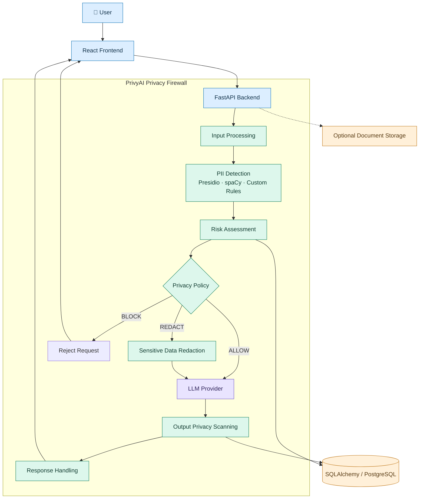
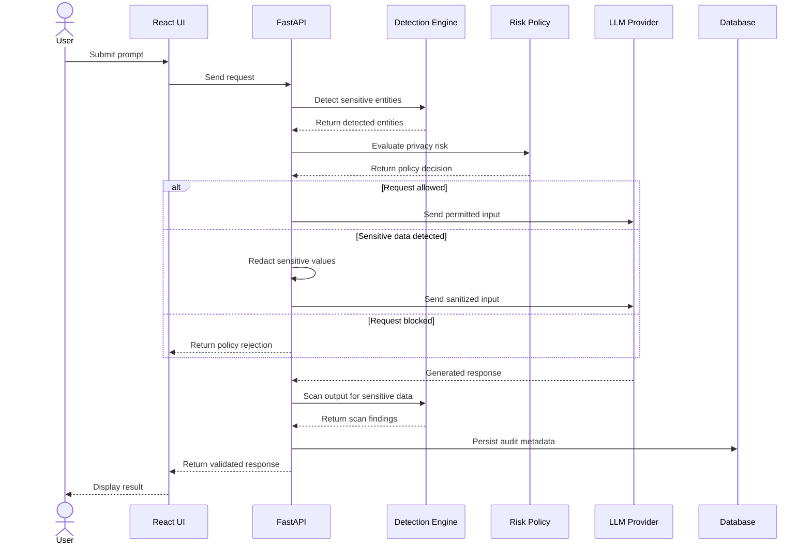

<div align="center">

# 🛡️ PrivyAI
### Your Privacy Firewall for AI

**Protecting Sensitive Information During AI Interactions**

[](https://www.python.org/)
[](https://fastapi.tiangolo.com/)
[](https://react.dev/)
[](https://www.postgresql.org/)
[](https://www.ibm.com/)

**IBM Z Datathon Project · Team Two Bits Ahead**

</div>

---

## 📌 Overview

**PrivyAI** is a privacy-aware AI assistant designed to reduce sensitive-data exposure during AI interactions.

It introduces a privacy firewall between users and AI models, detecting personally identifiable information (PII), evaluating privacy risks, redacting sensitive values before LLM processing, and scanning generated responses for potential data leaks.

The goal is to make AI interactions safer while preserving the usefulness of AI-generated responses.

## 🚨 Problem Statement

AI tools may unintentionally receive or expose sensitive information through:

- User prompts containing personal or financial details.
- Documents containing confidential information.
- Credentials, API keys, and authentication secrets.
- AI-generated responses that reveal sensitive information.

Traditional AI workflows may lack a dedicated privacy layer that checks both incoming prompts and generated responses.

**PrivyAI aims to address this gap through automated detection, risk-based policy enforcement, and output privacy validation.**

## 💡 Our Solution

PrivyAI acts as an intermediary privacy layer between users and AI models.

```text
User Input
    │
    ▼
Sensitive Data Detection
    │
    ▼
Risk Assessment
    │
    ▼
Privacy Policy Enforcement
    ├── ALLOW
    ├── REDACT
    └── BLOCK
    │
    ▼
LLM Processing
    │
    ▼
Output Privacy Scanning
    │
    ▼
Safe Response + Audit Metadata
```

The workflow is designed to minimize unnecessary exposure of sensitive information while retaining the context required for useful AI responses.

## ✨ Key Features

### 🔎 1. Sensitive Data Detection
- Detects PII and other sensitive entities.
- Uses Microsoft Presidio, spaCy, and custom detection rules.
- Supports configurable detection logic.

### 🛡️ 2. Risk-Based Policy Decisions
- Evaluates detected sensitive information.
- Calculates privacy risk scores.
- Supports ALLOW, REDACT, and BLOCK decisions according to configured policies.

### 🔐 3. Privacy-Preserving Redaction
- Masks sensitive values before LLM processing.
- Replaces detected entities with placeholders.
- Helps reduce unnecessary disclosure of personal information.

### 🤖 4. LLM Provider Abstraction
- Supports mock responses for development and testing.
- Provides integration interfaces for OpenAI, Google Gemini, and Anthropic.
- Requires provider configuration and credentials for real external API calls.

### ✅ 5. Output Privacy Scanning
- Scans generated responses for sensitive information.
- Supports privacy checks before returning responses.
- Helps identify potential data leakage.

### 📊 6. Audit Trail and Persistence
- Stores scan metadata and risk scores.
- Records detected entity categories and audit events.
- Uses SQLAlchemy with PostgreSQL-compatible database support.

---

## 🏗️ System Architecture

The following diagram illustrates the intended high-level architecture of PrivyAI.



**Architecture layers**

| Layer | Responsibility |
|---|---|
| Frontend | User interaction and presentation |
| API Layer | Request handling and backend coordination |
| Detection Layer | Identifies sensitive entities |
| Policy Layer | Evaluates risk and determines privacy actions |
| Redaction Layer | Sanitizes sensitive information |
| LLM Layer | Processes sanitized input |
| Output Validation | Checks generated responses |
| Persistence Layer | Stores audit metadata and risk information |

> **Implementation note:** This diagram describes the intended request flow. Verify the policy branches, document workflow, and complete frontend-to-backend integration against the current code before presenting them as fully tested.

---

## 🔄 Request Lifecycle

This sequence diagram shows how a request is intended to move through the privacy firewall.



*The sequence is a design-level representation; actual execution order depends on the implemented backend flow and configured provider.*

---

## 🧰 Technology Stack

| Category | Technology | Purpose |
|---|---|---|
| Frontend | React.js | User interface |
| Backend | Python | Core application logic |
| API Framework | FastAPI | Request handling and API endpoints |
| PII Detection | Microsoft Presidio | Sensitive entity detection |
| NLP | spaCy | NLP-based entity recognition |
| Detection Rules | Regex and custom rules | Pattern-based detection |
| ORM | SQLAlchemy | Database interaction |
| Database | PostgreSQL-compatible database | Audit and scan persistence |
| LLM Integration | OpenAI, Gemini, Anthropic | Configurable AI providers |
| Development | Git and GitHub | Version control |

**Enterprise platform:** IBM Z / LinuxONE is the planned deployment environment; deployment verification remains pending.

---

## 🔐 Privacy Risk Scoring

PrivyAI uses a configurable risk-scoring approach to help determine the appropriate privacy action.

### Illustrative formula

\[
R = \sum_{i=1}^{n} w_i \times s_i
\]

Where:

- \(R\) = Overall privacy risk score.
- \(w_i\) = Configured risk weight for an entity type.
- \(s_i\) = Detected count or severity for that entity.

### Example risk weights

| Entity Type | Example Weight |
|---|---:|
| Email address | 1 |
| Phone number | 2 |
| Financial identifier | 3 |
| API key / Authentication secret | 5 |

### Risk-based actions

| Risk Level | Possible Action |
|---|---|
| Low | Allow with appropriate protections |
| Medium | Redact sensitive values |
| High | Block according to security policy |

These weights and levels are illustrative. Actual thresholds and decisions depend on the configured policy implementation.

---

## 🧪 Testing and Evaluation

PrivyAI's evaluation plan covers sensitive-data detection, redaction, privacy policy behaviour, and response usefulness.

### Dataset Sources

- **PII-Bench:** Context-aware PII detection and masking experiments.
- **CoNLL-2003:** General named-entity recognition experiments.
- **Synthetic datasets:** Names, emails, phone numbers, financial details, passwords, and API keys.
- **Custom test cases:** Documents, emails, reports, adversarial prompts, and malicious document instructions.

### Evaluation Metrics

| Metric | Purpose |
|---|---|
| Precision | Measures how many detected entities are correct |
| Recall | Measures how many relevant entities are detected |
| Masking Accuracy | Evaluates correct sensitive-value replacement |
| False-Positive Rate | Measures normal content incorrectly flagged |
| Leakage Prevention | Evaluates sensitive data appearing in generated responses |
| Response Usefulness | Assesses output quality after redaction |

**Data safety:** Use synthetic or appropriately licensed public data. Do not use real personal or confidential information in test cases.

*These are evaluation objectives, not claimed benchmark results. Add measured values after running the experiments.*

---

## 📊 Implementation Status

| Component | Status |
|---|---|
| Sensitive data detection | Implemented in code |
| Risk scoring and policy decisions | Implemented in code |
| Privacy-preserving redaction | Implemented in code |
| Output privacy scanning | Implemented in code |
| LLM provider abstraction | Implemented; real calls require configuration |
| Audit metadata and persistence | Implemented in code; end-to-end behaviour needs verification |
| React frontend and document workflows | Integration requires verification |
| IBM Z / LinuxONE deployment | Verification pending |

This table reflects the implementation status shared during project documentation and should be updated as additional tests are completed.

---

## 🚀 Getting Started

### Prerequisites

- Python 3.10 or a version supported by the project dependencies.
- Node.js and npm for the React frontend.
- PostgreSQL or a database supported by the application configuration.
- Provider API credentials if using a real external LLM.

### 1. Clone the repository

```bash
git clone <YOUR_GITHUB_REPOSITORY_URL>
cd <YOUR_REPOSITORY_FOLDER>
```

### 2. Set up the backend

Create a virtual environment:

```bash
python -m venv .venv
```

Activate it on Windows:

```powershell
.venv\Scripts\activate
```

Or on Linux/macOS:

```bash
source .venv/bin/activate
```

Install dependencies from the directory containing the backend requirements file:

```bash
pip install -r requirements.txt
```

### 3. Configure environment variables

Create a `.env` file using the variable names expected by your application.

Example:

```env
DATABASE_URL=your_database_connection_url
SECRET_KEY=your_application_secret
```

Add provider credentials only if required by your configured LLM integration.

**Never commit `.env` files, passwords, API keys, or database credentials to GitHub.**

### 4. Start the backend

If the FastAPI entry point is `app/main.py`, use:

```bash
uvicorn app.main:app --reload
```

Adjust the command to match your actual entry point.

### 5. Start the frontend

From the frontend directory:

```bash
npm install
npm run dev
```

Use the actual frontend directory and scripts defined in your repository.

> The commands above are a setup template. Confirm your repository structure, requirements-file location, environment variables, and entry points before treating these instructions as verified.

---

## 🖥️ IBM Z and LinuxONE

PrivyAI explores privacy-aware AI processing for enterprise environments.

Potential deployment benefits include:

- Centralized privacy enforcement for AI requests.
- Sensitive-data detection before external model processing.
- Configurable policy decisions and output validation.
- Audit metadata for monitoring and review.

**Current status:** Deployment and environment-specific integration verification are pending.

The project does not claim production deployment, IBM Z performance benchmarks, or verified enterprise compliance.

---

## 🔮 Future Scope

- Complete end-to-end frontend and backend integration.
- Configure and validate real LLM provider calls.
- Improve document extraction and privacy protection.
- Evaluate detection accuracy using public datasets and synthetic samples.
- Test adversarial prompts and malicious document instructions.
- Refine configurable risk policies and privacy monitoring.
- Validate deployment on IBM LinuxONE or another supported IBM Z environment.

---

## 👥 Team

**Team Name:** Two Bits Ahead  
**Project:** PrivyAI — Your Privacy Firewall for AI  
**Event:** IBM Z Datathon

---

## 📄 License

Add a suitable open-source license before publicly distributing the project. Ensure that the selected license is compatible with your dependencies and datasets.

---

<div align="center">

### 🛡️ PrivyAI

**Secure AI. Protected Data. Responsible Innovation.**

</div>
